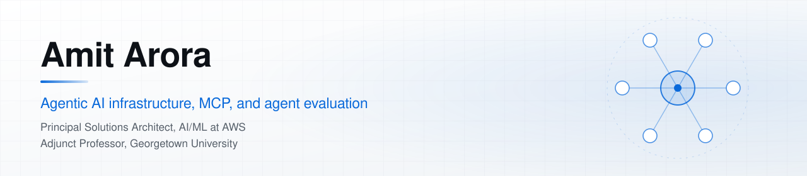

<picture>
  <source media="(prefers-color-scheme: dark)" srcset="https://raw.githubusercontent.com/aarora79/aarora79/main/assets/hero-dark.svg">
  <source media="(prefers-color-scheme: light)" srcset="https://raw.githubusercontent.com/aarora79/aarora79/main/assets/hero-light.svg">
  
</picture>

  
  
  
  
  

I work on the infrastructure layer of enterprise agentic AI: the gateways and registries that let agents
discover and call tools under real authentication and audit, and the benchmarks that tell you which model
to trust for a given job. Most of it ships in the open, gets deployed by large enterprises, and then comes
back as issues and pull requests that shape the next version.

Day job is Principal Solutions Architect for AI/ML at AWS, where I help some of the largest enterprises
build and run their agentic platforms. Evenings I teach graduate students at Georgetown, where I created
the applied generative AI course. I hold 26 patents from a prior decade in satellite telecommunications
and applied machine learning.

---

## Flagship open source

| Project | Role | What it is |
|---|---|---|
| **[mcp-gateway-registry](https://github.com/agentic-community/mcp-gateway-registry)**     | Lead architect, lead developer, GTM lead | Enterprise MCP gateway and registry for AI assets: agents, MCP servers, and skills. OAuth and OIDC via Keycloak, Microsoft Entra ID, and Okta, dynamic tool discovery, and auditable tool access. Runs on Kubernetes, ECS, and Docker across AWS, Azure, and GCP, with 180+ enterprise deployments and integrations into Claude Code, Codex, and Kiro. 60+ contributors. [Submitted to the AAIF](https://github.com/aaif/project-proposals/issues/29) for adoption. |
| **[hal-harness](https://github.com/princeton-pli/hal-harness)**    | Co-author, ICLR 2026 | The Holistic Agent Leaderboard (HAL), a standardized harness for evaluating AI agents, built with Princeton University researchers. Co-presented the paper at ICLR 2026. |
| **[FMBench](https://github.com/aws-samples/foundation-model-benchmarking-tool)**    | Creator | Foundation model benchmarking across hardware platforms and serving stacks, so teams can pick an instance and a model on measured cost and latency rather than intuition. Co-presented with Netflix at AWS re:Invent 2024 (NFX307). |
| **[agentic-coding-harness-benchmarks](https://github.com/aarora79/agentic-coding-harness-benchmarks)**    | Creator | Measures how open weight and frontier models actually perform on long horizon coding tasks, across harnesses (Claude Code, pi, omp, Kiro CLI) and hosting paths (Amazon Bedrock, LiteLLM proxy, self hosted vLLM on EC2). 18 models over 21 real tasks from real repositories, reduced to a cost and quality Pareto frontier. Ships `swe-router`, a skill that reads the frontier and names the cheapest model clearing the quality bar: 45% lower cost for 4.6% less quality. [Slides](https://github.com/aarora79/agentic-coding-harness-benchmarks/blob/main/docs/slides/agentic-coding-benchmarks-presentation.html). |
| **[aws-cost-explorer-mcp-server](https://github.com/aarora79/aws-cost-explorer-mcp-server)**    | Creator | An early MCP server, written weeks after the protocol shipped, that lets you ask plain language questions about your AWS spend. Widely forked as a reference for building real MCP servers. |
| **[openapi-to-mcp](https://github.com/agentic-community/openapi-to-mcp)**    | Creator | Turns an existing OpenAPI specification into a production ready MCP server, using an LLM to analyze the API surface and improve the generated tool definitions. |
| **[agentic-primitives-gateway](https://github.com/agentic-community/agentic-primitives-gateway)**    | Contributor | A gateway for separating tools from agent code, so the tool surface can evolve without redeploying agents. |

## Talks and papers

Available to speak on enterprise MCP architecture, agent evaluation methodology, agentic coding
economics, and running open weight models in production. Slides and prior recordings on request.

| Year | Venue | Session |
|---|---|---|
| 2026 | **ICLR** | Holistic Agent Leaderboard (HAL), co-presented with Princeton University researchers |
| 2026 | **ACM AgentSkills (CAIS Workshop)** | [From Observed Reasoning to Stable Skills: A Memory Substrate for Skill Graduation](https://openreview.net/forum?id=yCsHQnvvWY). Introduces the Cognitive Memory Manager for skill graduation in coding agents |
| 2026 | **MCP Dev Summit, NYC and Amsterdam** | MCP Gateway and Registry: architecture and enterprise adoption patterns |
| 2025 | **AWS re:Invent** | AIM3314, debug, trace, improve: observability for agentic applications (chalk talk)   ISV325, securing AI agent ecosystems: MCP server and agent security at scale |
| 2024 | **AWS re:Invent** | NFX307, benchmarking FMs and LLMs across hardware platforms, with Netflix (CSAT 4.75)   AIM307, reducing FM deployment cost and latency with Amazon SageMaker (CSAT 4.75) |
| 2024 | **AWS AI/ML Symposium** | Joint presentation with an enterprise telecommunications customer |
| 2023 | **AWS re:Invent** | AIM305, building scalable RAG applications with Amazon Bedrock Knowledge Bases |
| 2019 | **ScAINet, EARL** | Applied machine learning in telecommunications networks |

Also the holder of 26 granted patents in satellite telecommunications and applied machine learning.

## Writing

Thirteen posts on the AWS blogs, four of them co-authored with the customer whose system they describe.

| Date | Post |
|---|---|
| Jun 2026 | [Governing AI assets at scale with MCP Gateway and Registry](https://aws.amazon.com/blogs/opensource/governing-ai-assets-at-scale-with-mcp-gateway-and-registry/)   AWS Open Source Blog |
| May 2026 | [Securing AI agents: how AWS and Cisco AI Defense scale MCP and A2A deployments](https://aws.amazon.com/blogs/machine-learning/securing-ai-agents-how-aws-and-cisco-ai-defense-scale-mcp-and-a2a-deployments/) |
| Sep 2025 | [Build multi-agent site reliability engineering assistants with Amazon Bedrock AgentCore](https://aws.amazon.com/blogs/machine-learning/build-multi-agent-site-reliability-engineering-assistants-with-amazon-bedrock-agentcore/) |
| Apr 2025 | [Harness the power of MCP servers with Amazon Bedrock Agents](https://aws.amazon.com/blogs/machine-learning/harness-the-power-of-mcp-servers-with-amazon-bedrock-agents/) |
| Dec 2024 | [Talk to your slide deck using multimodal foundation models on Amazon Bedrock, Part 3](https://aws.amazon.com/blogs/machine-learning/talk-to-your-slide-deck-using-multimodal-foundation-models-on-amazon-bedrock-part-3/) |
| Aug 2024 | [How Cisco accelerated the use of generative AI with Amazon SageMaker Inference](https://aws.amazon.com/blogs/machine-learning/how-cisco-accelerated-the-use-of-generative-ai-with-amazon-sagemaker-inference/) |

<b>Earlier posts</b> (2023 to 2024)

 

| Date | Post |
|---|---|
| Aug 2024 | [How Twilio generated SQL using Looker Modeling Language data with Amazon Bedrock](https://aws.amazon.com/blogs/machine-learning/how-twilio-generated-sql-using-looker-modeling-language-data-with-amazon-bedrock/) |
| Jun 2024 | [How Twilio used Amazon SageMaker MLOps pipelines with PrestoDB to enable frequent model retraining and optimized batch transform](https://aws.amazon.com/blogs/machine-learning/how-twilio-used-amazon-sagemaker-mlops-pipelines-with-prestodb-to-enable-frequent-model-retraining-and-optimized-batch-transform/) |
| Apr 2024 | [Use Kubernetes Operators for new inference capabilities in Amazon SageMaker that reduce LLM deployment costs by 50% on average](https://aws.amazon.com/blogs/machine-learning/use-kubernetes-operators-for-new-inference-capabilities-in-amazon-sagemaker-that-reduce-llm-deployment-costs-by-50-on-average/) |
| Apr 2024 | [Talk to your slide deck using multimodal foundation models hosted on Amazon Bedrock and Amazon SageMaker, Part 2](https://aws.amazon.com/blogs/machine-learning/talk-to-your-slide-deck-using-multimodal-foundation-models-hosted-on-amazon-bedrock-and-amazon-sagemaker-part-2/) |
| Jan 2024 | [Talk to your slide deck using multimodal foundation models hosted on Amazon Bedrock and Amazon SageMaker, Part 1](https://aws.amazon.com/blogs/machine-learning/talk-to-your-slide-deck-using-multimodal-foundation-models-hosted-on-amazon-bedrock-and-amazon-sagemaker-part-1/) |
| Nov 2023 | [Build a foundation model powered customer service bot with Amazon Bedrock agents](https://aws.amazon.com/blogs/machine-learning/build-a-foundation-model-fm-powered-customer-service-bot-with-amazon-bedrock-agents/) |
| Mar 2023 | [Use Snowflake as a data source to train ML models with Amazon SageMaker](https://aws.amazon.com/blogs/machine-learning/use-snowflake-as-a-data-source-to-train-ml-models-with-amazon-sagemaker/) |

## Teaching

I created and teach **DSAN-6725, Applied Generative AI for AI Developers** in Georgetown University's
M.S. in Data Science and Analytics program, one of the first comprehensive generative AI courses offered
in academia. It is now the most popular course in the program, runs in both Spring and Fall, and earned a
perfect 5 out of 5 in student reviews for Spring 2026. I also teach **DSAN-6000, Big Data and Cloud
Computing**, and am building a new graduate course on AI agents. 500+ graduate students so far.

Public course material and learning paths I maintain:

| Repository | For |
|---|---|
| [ai-learning-path](https://github.com/aarora79/ai-learning-path) | A self paced six week program to a working 200 level grasp of modern AI, three weeks of it on agents, with hands on Amazon Bedrock labs |
| [k8s-100-to-mcp-gateway](https://github.com/aarora79/k8s-100-to-mcp-gateway) | Kubernetes from zero containers to two capstones, running the MCP Gateway Registry and serving an LLM locally, in 13 phases |
| [ai-everyday-life](https://github.com/aarora79/ai-everyday-life) | A weekend course on AI for people who do not write code |
| [personal-knowledge-base](https://github.com/aarora79/personal-knowledge-base) | An LLM authored, interlinked wiki on generative AI, compiled from clipped primary sources |

## Currently building

- **[my-ai-assets](https://github.com/aarora79/my-ai-assets)**, prompt and skill templates for systematic analysis work, including a Feynman technique framework for reading papers.
- **[claude-code-usage-analyzer](https://github.com/aarora79/claude-code-usage-analyzer)**, cost and token accounting for coding agents, broken down by model and token type.
- **[simple-agentcore](https://github.com/aarora79/simple-agentcore)** and **[pingmcp](https://github.com/aarora79/pingmcp)**, minimal reference deployments for Amazon Bedrock AgentCore and a fast Go MCP server for load testing gateways.
- **[local-coding-assistants](https://github.com/aarora79/local-coding-assistants)** and **[coding-with-ai](https://github.com/aarora79/coding-with-ai)**, running coding agents on open models, and notes on what actually changes when you work this way.

## Stack

**Languages** Python, Go, R, C and C++, Scala, SQL

**Agents and models** MCP, A2A, Amazon Bedrock, Amazon Bedrock AgentCore, Amazon SageMaker, Anthropic Claude,
Amazon Nova, Meta Llama, LangGraph, vLLM, LiteLLM, Unsloth, Ragas

**Platform** Kubernetes and EKS, ECS, Lambda, Keycloak, Microsoft Entra ID, Okta, OpenTelemetry, NGINX,
Terraform, OpenSearch, DynamoDB

**Data** Polars, DuckDB, Spark, Kafka

 

  Maryland, USA &nbsp;·&nbsp; <a href="https://www.linkedin.com/in/amit-arora-539120a/">LinkedIn</a> &nbsp;·&nbsp; <a href="https://twitter.com/aarora79">X</a>

